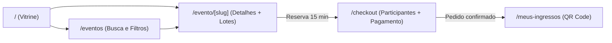

# Arquitetura do Frontend — Sympla Clone

## Visão Geral

O projeto segue o padrão **Next.js App Router** (`src/app/`) com separação clara entre:
- **Camada de Dados e Tipos (`src/data/events.ts`)**: definição das interfaces `SymplaEvent`, `TicketLot`, `CollectionItem`, `CategoryItem` e catálogo inicial.
- **Gerenciamento de Estado (`src/context/SymplaContext.tsx`)**: estado global compartilhado entre todas as rotas via React Context + persistência local (`localStorage` / `sessionStorage`).
- **Design System Híbrido (`src/styles/` + `src/app/globals.css`)**:
  - **Tailwind CSS v4** (`@theme inline`) para layout, responsividade e utilitários rápidos.
  - **Vanilla Extract** (`@vanilla-extract/css` com `@vanilla-extract/next-plugin`) para tokens globais (`symplaVars`) e animações/estados de componentes (`eventCardRoot`, `stickyTicketCard`, `accordionItem`, `accordionTrigger`, `accordionContent`, `primaryBrandButton`).
- **Primitivos Acessíveis (`Radix UI`)**:
  - `@radix-ui/react-dropdown-menu`: seletor de cidade e menu do usuário autenticado.
  - `@radix-ui/react-dialog`: modal de login, seletor mobile de ingressos e visualização de QR Code em `/meus-ingressos`.
  - `@radix-ui/react-accordion`: seção de dúvidas frequentes (FAQ) na página inicial.
  - `@radix-ui/react-tabs`: seleção da forma de pagamento no checkout (`PIX`, `Cartão`, `Boleto`).

## Fluxo Crítico de Compra



## Como Recriar do Zero (Guia Rápido)

Caso queira reproduzir a criação deste projeto em outra máquina a partir de um diretório vazio:

```bash
mkdir sympla-clone && cd sympla-clone
npm init -y
npm install next react react-dom lucide-react \
  @radix-ui/react-accordion @radix-ui/react-dialog \
  @radix-ui/react-dropdown-menu @radix-ui/react-tabs \
  @vanilla-extract/css @vanilla-extract/next-plugin
npm install -D typescript @types/node @types/react @types/react-dom \
  tailwindcss @tailwindcss/postcss eslint eslint-config-next
```

Em seguida, configure o plugin `@vanilla-extract/next-plugin` em `next.config.ts` e o `@tailwindcss/postcss` em `postcss.config.mjs`.
